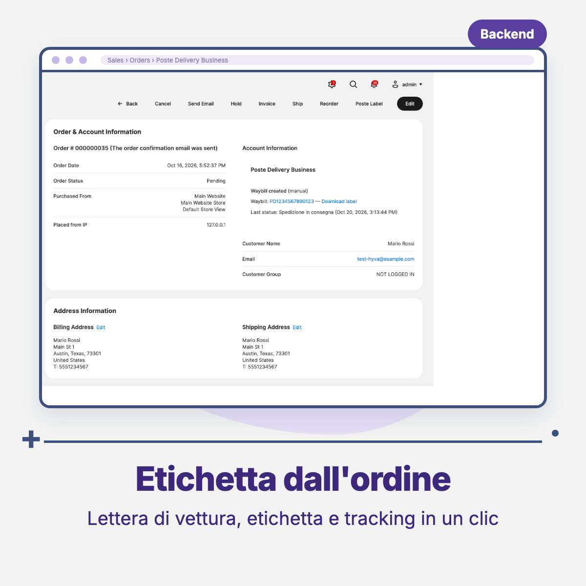
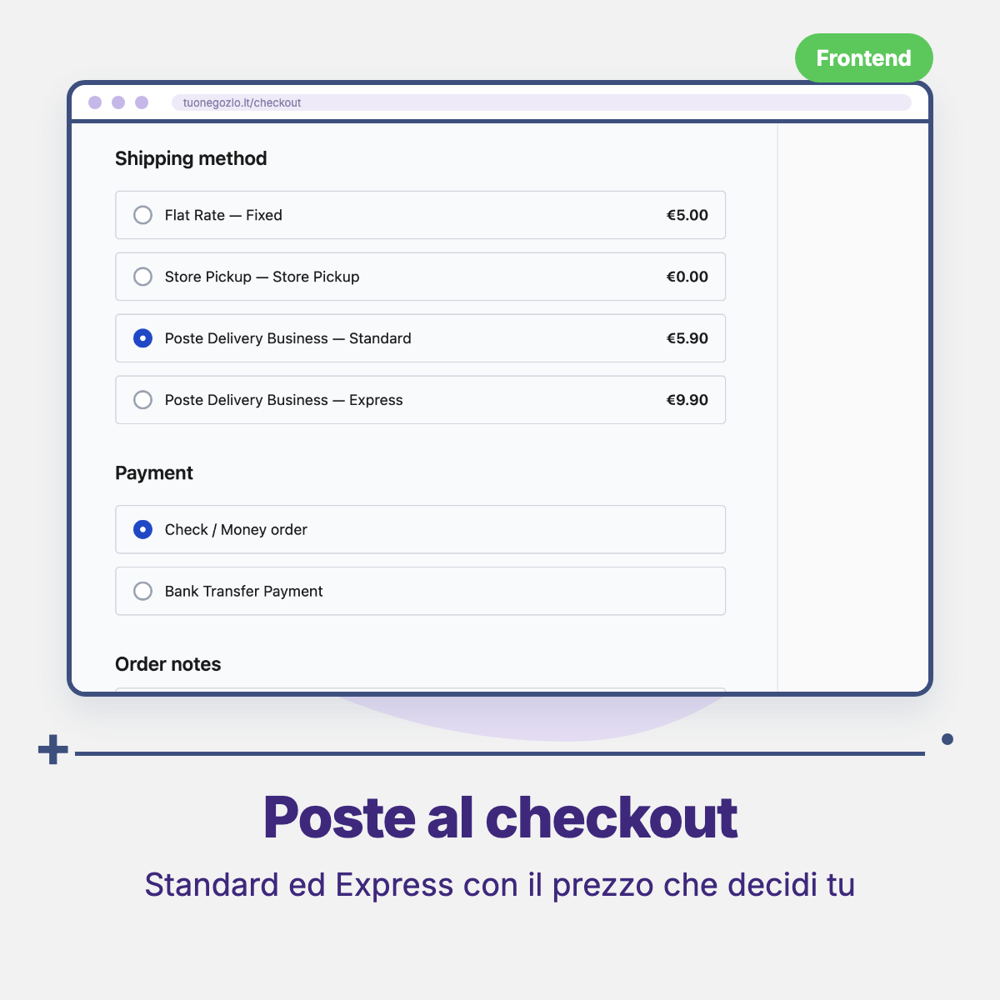
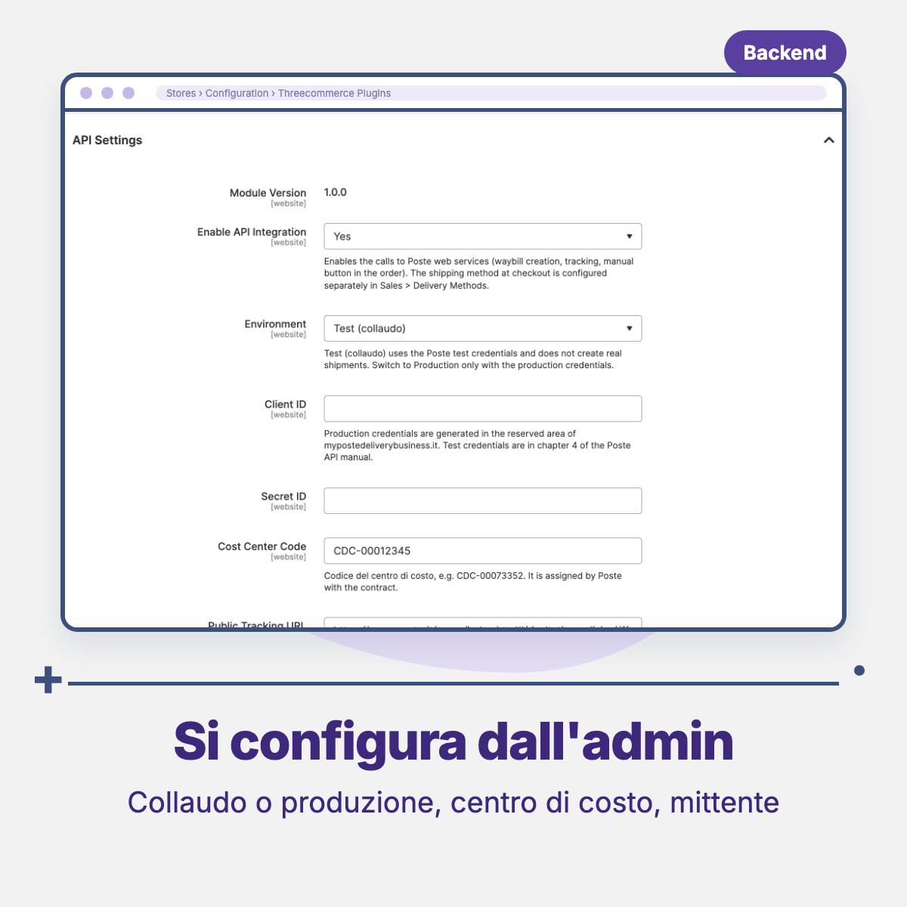

# Threecommerce_PosteDelivery: Poste Delivery Business integration for Magento 2 / Mage-OS

Connects Magento 2 and Mage-OS to **Poste Delivery Business** (Poste Italiane API): a shipping method at checkout, waybill and label created from the order, and tracking updates shown in the order. No more copying addresses, labels and tracking numbers by hand into the Poste portal.

**Compatibility:** Magento Open Source / Adobe Commerce 2.4.4 – 2.4.9 · Mage-OS 1.x / 3.x · PHP 8.1 – 8.4
**License:** commercial · coming soon

## Features

- **Shipping method** `Poste Delivery Business` with two services, **Standard** and **Express**, a fixed price per service, a free shipping threshold and Italy only. It can be shown to customers at checkout or reserved for orders created from the admin.
- **Waybill creation** through the Poste API: the label is saved on the server (A4, 10x11 or ZPL), the Magento shipment is created with the tracking number linked to the carrier, and an optional shipment e-mail goes to the customer.
- **Create Poste Waybill** and **Poste Label** buttons on the order, available for any shipping method.
- **Automatic creation** by cron every 5 minutes for orders that use a Poste method, off by default, with a start date, order statuses, optional invoice requirement and a maximum number of attempts.
- **Tracking**: cron every 30 minutes on open shipments, latest status shown in the order, optional order comment on delivery, configurable public tracking link.
- **Test and production environments**; the Secret ID is stored encrypted and the credentials are checked when you save the configuration.
- Everything is **off by default**: nothing is sent to Poste until you enable the API integration.

## Requirements

- Magento Open Source / Adobe Commerce 2.4.4+ or Mage-OS
- PHP 8.1 – 8.4 with `curl` and `json` extensions
- Package: `threecommerce/m2-base`
- An active Poste Delivery Business contract with Client ID, Secret ID and cost center code
- Magento cron running on the server

## Limitations

Domestic shipments only and one parcel per order. Cash on delivery, returns, pickups and stock are not covered in this version.

## Availability

This module is **not yet available to buy**. It is a commercial product and is coming soon. To be notified when it is released, or to ask for details, use the [product page](https://www.threecommerce.it/poste-delivery-business-magento-2?utm_source=github&utm_medium=readme&utm_campaign=magento2-poste-delivery) or [get in touch](https://www.threecommerce.it/contatti?utm_source=github&utm_medium=readme&utm_campaign=magento2-poste-delivery).

## Configuration

- *Stores → Configuration → Sales → Delivery Methods → Poste Delivery Business (Threecommerce)*: enable the method, show at checkout, service names and prices, free shipping from subtotal.
- *Stores → Configuration → Threecommerce Plugins → Poste Delivery Business*: API settings (environment, credentials, cost center, public tracking URL), sender data, shipment defaults (label format, weight, dimensions), automatic waybill creation and tracking.

## Documentation and support

- Product page: [threecommerce.it/poste-delivery-business-magento-2](https://www.threecommerce.it/poste-delivery-business-magento-2?utm_source=github&utm_medium=readme&utm_campaign=magento2-poste-delivery)
- [Changelog](CHANGELOG.md)
- Support and custom development: [threecommerce.it/contatti](https://www.threecommerce.it/contatti?utm_source=github&utm_medium=readme&utm_campaign=magento2-poste-delivery)

---

*This repository is the public showcase of the module. The source code is kept in a private repository.*
